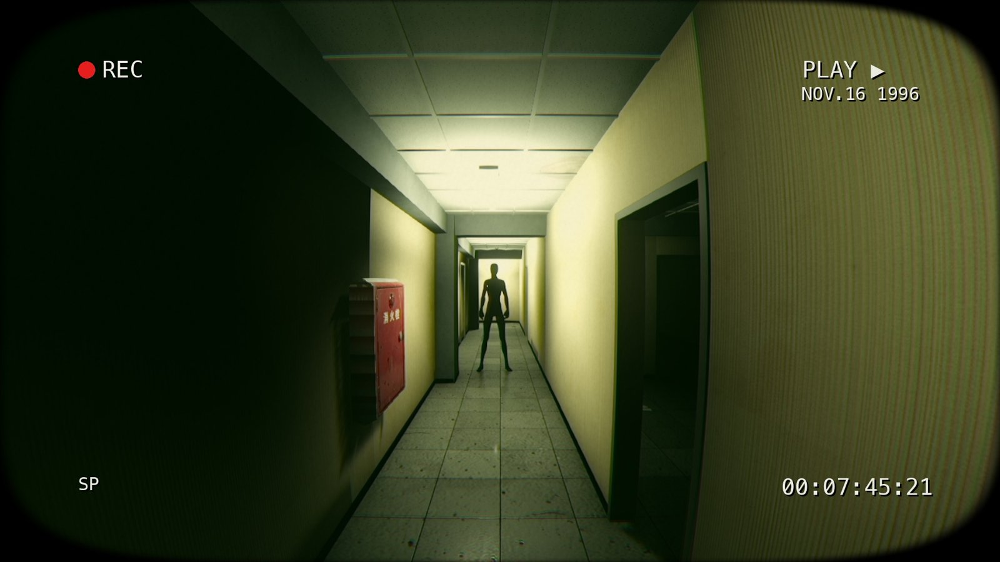

# LiminalTape



**ダウンロード / Download：[Releases](https://github.com/IVIX2020/liminaltape/releases/latest)**（Mac版・Windows版）

1996年11月16日、閉鎖された雑居ビルの3階。手持ちのビデオカメラのライトだけを頼りに、ブレーカーを3つ入れて非常階段から脱出する、一人称のファウンドフッテージ・ホラーです。

*A first-person found-footage horror game. 1996, an abandoned office floor. Turn on three breakers and escape by the emergency stairs — with only your camcorder light.*

## 遊び方 / How to play
| 操作 | キー |
|---|---|
| 移動 / Move | W A S D |
| 走る / Run（スタミナ制） | Shift |
| 視点 / Look | マウス |
| 使う / Use（ブレーカーは長押し） | E（長押し） |
| ライト / Light | F |
| 一時停止・設定 / Pause & settings | Esc |
| 終了画面 / End screen | R：やり直す（REWIND）／ Q：終了（EJECT） |

- **目的**：暗い部屋の赤いランプ（分電盤）を3つ探して、ブレーカーを入れる → 南西の非常口から脱出する。
- **敵**は、見たり聞いたりしてあなたを探す。明るい廊下は比較的安全。走ると音で気づかれる。直線では速いが、曲がり角では遅い。
- 敵が近づくと、蛍光灯が乱れ、息づかいが聞こえる。見つかると「ギュイッ」という音が鳴る。
- **設定（Esc）**：マウス感度、上下反転、音量、明るさ、画質、視野角、画面モード、解像度、難易度。

## 動作環境 / Requirements
- macOS（Intel と Apple シリコンの両方に対応。Unity 2022.3でビルド。Intel Mac（Radeon Pro 5500M）で、平均約55fps）
- 暗いゲームなので、部屋を暗くし、ヘッドホンで遊ぶのがおすすめ。

## Windows版 / Windows
`LiminalTape.exe` を実行してください（フォルダごと展開すること）。SmartScreenの警告が出たら「詳細情報 → 実行」。

## 初めて開くとき（Mac） / First launch on Mac (unsigned build)
署名していないアプリなので、macOSに「開発元を確認できない」と表示されます。次のどちらかで開いてください。
1. `LiminalTape.app` を**右クリック → 開く → 開く**
2. または、ターミナルで次を実行してから開く：
   ```bash
   xattr -cr LiminalTape.app
   ```

## 制作 / Credits
- AIチーム：Claude（Opus：指揮と実装／Sonnet：UI／Fable：顧問）、Gemini（Argon：相談役／Hydrogen：画像の診断とコード生成／Flash：プロンプト）
- 画像とテクスチャ：FLUX.2 klein（ローカルのComfyUI）
- 3Dモデル：Hunyuan3D v2（ローカル）、Blender、FreeCAD（建物の平面図）、Mixamo（敵のリグとアニメーション）
- エンジン：Unity 2022.3 / URP
- 音：すべてコードで合成（素材ファイルなし）
- 素材はすべて、生成したもの、またはコードで作ったもの。外部の素材ストアは使っていない。

制作の記録：[AIチームと1日でホラーゲームを作ったら、アセットを使わなかったことを後悔した話](https://ivix2020.github.io/my-astro-blog/blog/20261116-liminaltape/)

2026年11月16日、6時間ほどで作ったゲームです。ソースコードは公開していません。
